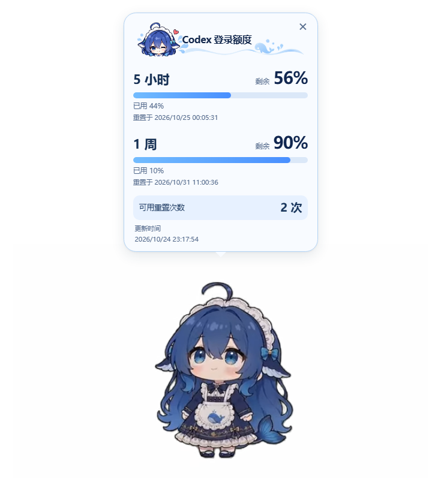

[简体中文](README.md) | [English](README.en.md)

# 蓝色大肥鱼 · Codex 额度卡片定制版

基于 [Refining-colors/pet-with-you](https://github.com/Refining-colors/pet-with-you) 的 Windows 桌宠定制，保留角色动画、桌面互动、聊天与 Codex 任务反馈，重点改善登录额度的可读性。

本仓库维护基于 1.0.2 的定制源码，并非上游官方发行版。上游安装包不包含本卡片，本仓库暂未发布定制安装器。

## 实际效果



截图由隔离预览生成，账户数值和日期均为模拟数据。

## 定制内容

- 按周期展示剩余比例、进度条、已用比例与完整重置时间。
- 单独展示可用重置次数和更新时间，区分 0 次与未提供数据。
- 浅蓝气泡配合透明 PNG 头像、水波，实际数值仍为实时可复制文字。
- 整体使用 60% 缩放，最大呈现宽约 216 CSS px；根据可用空间收窄，高度不足时仅滚动内容。
- 保留关闭及悬停暂停计时，不增加查询频率或模型调用。

原有 106 段动画及其他功能继续保留，详见 [使用手册](docs/USER_GUIDE.md)。

## 从源码运行

需要 Windows 10/11 与 Node.js 22.12+，首次安装会下载 Electron。

```powershell
git clone https://github.com/mobaibumo/pet-with-you-custom.git
cd pet-with-you-custom
npm ci --include=dev
npm start
```

`npm start` 是开发预览，使用 `.local/` 内的独立设置与 Codex 目录，不会自动读取日常账户或安装 Hooks，首次默认纯桌宠。`Start-Pet.cmd` 是日常源码入口，使用 Windows 用户数据目录。详见 [安装说明](docs/INSTALL.md) 与 [开发工作区](docs/WORKSPACE.md)。

## 预览与验证

```powershell
.\node_modules\electron\dist\electron.exe scripts/preview-quota.cjs
npm test
npm run test:ui
npm run check:docs
```

卡片预览使用模拟数据，结果存于 `qa-output/quota-redesign/`，检查完成后自动退出，不调用聊天模型。界面回归使用隔离数据与模拟服务；真实额度获取依赖兼容的 Codex 运行程序和账户状态，云端或远程任务可能无法完整识别。本次未重建或验证定制 Windows 安装器。

日常使用时，在设置开启 Codex 连接并在客户端审阅 Hooks。Hooks 联动与聊天来源配置是不同步骤。

## 代码导航

- `runtime/codex-quota.js`：额度模型与卡片 DOM。
- `runtime/codex-quota.css`：排版和缩放。
- `runtime/quota-header.png`：标题装饰。
- `quota.cjs`：已有额度获取流程。
- `scripts/preview-quota.cjs`：隔离预览检查。

## 来源与授权

独立桌宠基础：[Refining-colors/pet-with-you](https://github.com/Refining-colors/pet-with-you)。原作与动画来源：[PC2005-cloud/dsh-pet](https://github.com/PC2005-cloud/dsh-pet)。

现有代码许可和版权声明保留在 [LICENSE](LICENSE) 与 [LICENSE.upstream](LICENSE.upstream)。本次新增内容的许可选择尚待维护者确认。角色与动画保留上游非商业使用及署名条件；生成的角色装饰不因此扩大素材授权。详见 [ATTRIBUTION.md](ATTRIBUTION.md)。

分发许可未确认的字体保留在本地，不纳入 Git，界面使用系统字体。个人数据、密钥、安装目录、缓存、原始设计稿和测试产物均不属于上传范围。公开仓库前仍需确认新增内容许可和第三方素材的分发边界。

